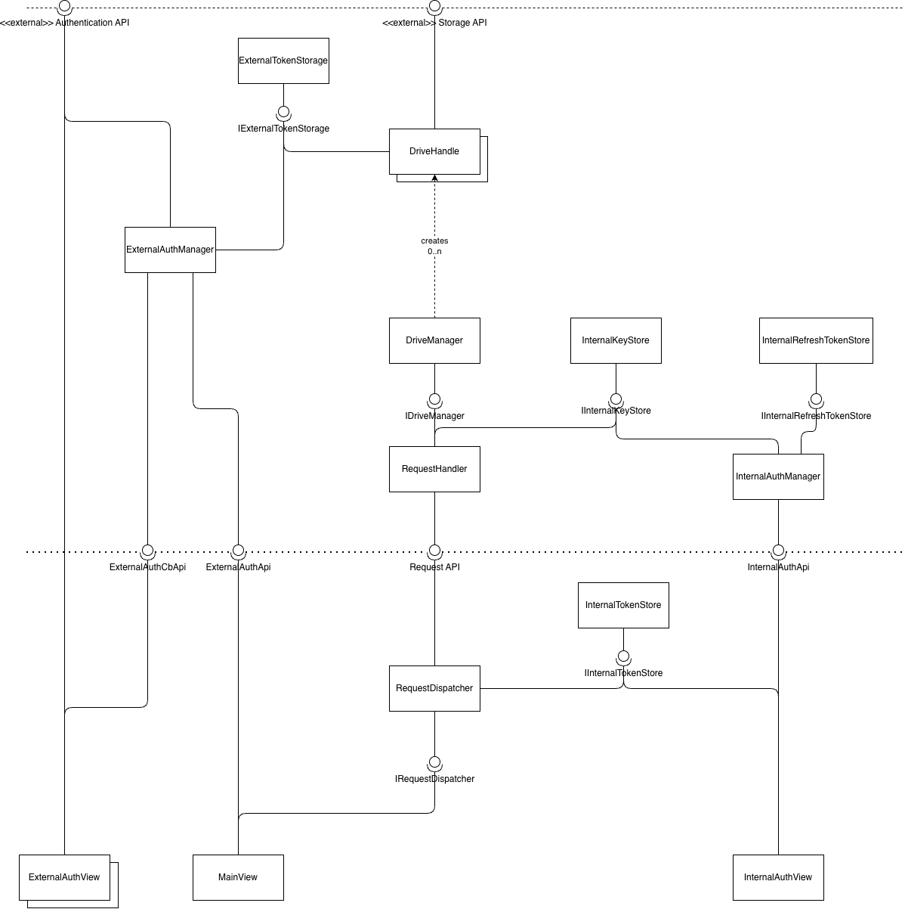

# System components and interfaces

## Component diagram

## Interfaces

### Backend - Public Interfaces

#### RequestAPI

Expects:
- request in JSON format regarding business logic (but not authorization)

Returns:
- response to request in JSON format

#### InternalAuthApi

Expects:
- request for access token (format not yet specified)
- request for refresh token (format not yet specified)

Returns:
- response with access token (format not yet specified)
- response with refresh token (format not yet specified)
- "request denied" response (format not yet specified)

#### ExternalAuthApi

Expects:
- request for external authentication in JSON format

Returns:
- HTTP redirect response containing a URL to a ExternalAuthView
- HTTP "request denied" response

#### ExternalAuthCbApi

Expects:
- temporary authentication code to request external Access Token and Refresh Token (format not yet specified)

Returns:
- ??? no reponse